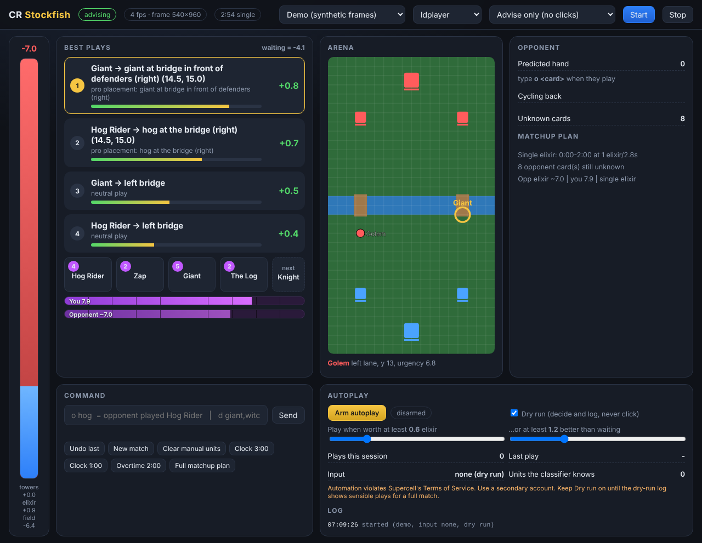

# CR Stockfish — a Clash Royale engine that advises, learns, simulates, and can play

`crsf` reads a Clash Royale match from the screen (Google Play Games on PC,
an emulator, or an Android phone), reconstructs the game state, ranks every
card × placement the way Stockfish ranks moves, explains why, and can click
the plays itself — through window messages (your mouse never moves), real
mouse clicks, or ADB taps.



## Read this first: what is real and what is not

| Claim | Reality |
|---|---|
| "Plays like a pro" | A strong, explainable rule-based engine: researched counter matrix for every card, 167 named pro placements, timing techniques, cycle/elixir tracking, archetype-aware matchup plans, a one-ply look at the opponent's reply, weights tuned by self-play and gated by a pro-puzzle benchmark (25/25). It is not pro level. No Clash Royale bot is. |
| "Never makes a mistake" | No engine achieves that. This one tells you why it chose a move so you can correct the knowledge files. |
| "Learned from pro videos" | Nothing here watched a video. `crsf learn` extracts placements while a pro's match plays on your screen; `crsf priors` turns them into statistics the engine uses. |
| "Knows every card" | 123 cards with level-11 stats (28 numbers still flagged unverified), roles, counters, placements; `knowledge/mechanics.json` seeds abilities, 42 evolutions, 18 hero forms and tower troops but most entries are not yet verified. See `TOMORROW.md`. |
| "Simulated 10,000 games" | Yes, in a simplified two-lane simulator (spawners, death spawns, ramp, charge, spells, towers, overtime). Numbers compare decks and weights against each other; they are not ladder predictions. |
| "Plays for me" | Yes (`crsf play` / GUI autoplay). Supercell's terms prohibit it; accounts get banned. Secondary account, training camp and friendlies. iOS cannot be automated without a jailbreak. |

Research caveat: the build environment could not fetch Deck Shop, the wiki or
RoyaleAPI directly, so the knowledge files were built from web-search summaries
plus model knowledge. Every entry carries its sources; `"knowledge"` means
expert estimate.

## Install

```bash
cd cr-stockfish
python -m venv .venv && . .venv/bin/activate      # Windows: .venv\Scripts\activate
pip install -r requirements.txt
pip install pygetwindow pyautogui pytesseract      # window capture, mouse input, OCR (optional)
python -m pytest tests -q                           # 62 tests
python -m crsf bench                                # 25/25 pro puzzles
```

Python 3.10+. Linux may need `sudo apt install python3-tk tesseract-ocr`.

## Zero-setup start (Windows)

Double-click **`start.bat`** in this folder. It finds Python 3.10–3.12 (or
installs 3.12 with winget), creates a virtual environment, installs the
dependencies, downloads the card icons, waits for the "Clash Royale" window and
opens the dashboard. If anything is off, `python -m crsf doctor` lists what is
missing and how to fix it.

## One command

```bash
python -m crsf go
```

Finds the "Clash Royale" window (Google Play Games on PC, scrcpy, any
emulator window), downloads the official card icons so your hand is read with
no labelling, calibrates on the live frame, and opens the dashboard in advise
mode with no-mouse clicking ready (arm it from the page; dry run is on by
default). `--live` starts with dry run off; `--input mouse|adb|none` changes
the input path.

## The dashboard

```bash
python -m crsf gui            # opens an app window at http://127.0.0.1:8765
python -m crsf gui --demo     # same, running on synthetic frames
```

Pick the source (window titled "Clash Royale", a monitor, or an emulator over
ADB), pick how clicks are sent, press Start. The page shows the eval bar,
ranked plays with reasons, an arena minimap with units and the recommended
tile, your hand and both elixir bars, the opponent's predicted hand and
cycle, the matchup plan, autoplay controls (arm, dry run, thresholds) and a
command box with card-name autocomplete.

**Card counter & elixir tracker.** All eight opponent cards with their state
(in hand / back in N plays / unknown, with EVO and HERO badges), the next card
coming back, the opponent's elixir estimate with a "could be as low as" band,
an elixir sparkline, a leak alarm when they sit at 10, elixir spent by each
side, the running lead (whole match and last 30 s), the last trades with
their net value, and your own cycle. Every `o <card>` you type feeds it.

## Google Play Games on PC (your setup)

| Step | Command |
|---|---|
| Check the HUD boxes | `python -m crsf calibrate --window "Clash Royale" --out preview.png` |
| Teach it your 8 cards (once) | `python -m crsf learn-cards --window "Clash Royale"` then `python -m crsf label <crop.png> hog_rider` |
| Advise | `python -m crsf advise --window "Clash Royale"` or the GUI |
| Play, cursor untouched | `python -m crsf play --window "Clash Royale" --input winmsg --dry-run` → drop `--dry-run` |
| Play with real clicks | `python -m crsf play --window "Clash Royale" --input mouse` (cursor restored after each play; slam it into a corner to abort) |

Google Play Games exposes no ADB, so window messages or mouse clicks are the
options there. The HUD layout in `crsf/data/layout.json` was measured from a
Google Play Games screenshot (556×990 game area) and the frame is found by
the green arena and the purple elixir bar, so a grey sidebar or desktop around
the game is fine.

## Emulators and phones (ADB: fully independent of your mouse)

| Target | Setup |
|---|---|
| LDPlayer 9 | Settings → Other → ADB debugging: local connection; display Phone 1080×1920. `--emulator ldplayer` |
| BlueStacks 5 | Settings → Advanced → Android Debug Bridge on; the port is shown there. `--emulator bluestacks` or `--connect 127.0.0.1:<port>` |
| MEmu / Nox / MuMu | ADB on by default: 21503 / 62001 / 7555 |
| Android phone | Developer options → USB debugging; `--emulator phone`, or `adb tcpip 5555` once and `--connect <phone-ip>:5555` |

`adb devices` must list the target as `device`. Then `python -m crsf play --emulator ldplayer --dry-run`.

## Commands

| Command | What it does |
|---|---|
| `analyze state.json` | Analyse a position (the Clash Royale "FEN"; see `examples/`) |
| `matchup "my 8 cards" "their 8 cards"` | Answer assignment per enemy card, danger cards, win paths, spell targets, reserve rules, archetype plan |
| `advise` / `play` / `gui` | Live advisor, autoplay, dashboard |
| `learn` / `priors` | Log deploy events from gameplay on screen; build placement priors |
| `simulate --games 10000` | Self-play over meta + generated decks → `reports/simulation_report.md` |
| `tournament` | Full round-robin of the meta decks, five player styles (aggressive, defensive, slow, spammer, mid-ladder) against the engine, and an aggression-threshold sweep → `reports/strategy_report.md` |
| `fetch-icons` | Official card icons as hand templates (what `go` does automatically) |
| `tune` | Evolve engine weights by self-play, promoted only if the puzzle benchmark does not regress → `knowledge/weights.json` |
| `bench` | Score the engine on `benchmarks/puzzles.json` |
| `replay`, `calibrate`, `learn-cards`, `label`, `cards` | Tooling |

### In-match commands (GUI box or terminal)

| Command | Meaning |
|---|---|
| `o hog` | opponent played Hog Rider → cycle, elixir estimate, and the enemy unit that just appeared is labelled |
| `u` / `r` | undo last opponent play / reset for a new match |
| `d giant,witch,...` / `m hog,musk,...` | set decks → archetype detection and the matchup plan; prefix `evo ` or `hero ` (e.g. `d evo knight, hero musketeer, ...`) and the engine treats those as harder to answer |
| `e 4` / `t 2:30` / `t 1:00 ot` | override opponent elixir / clock |
| `x balloon opp right` / `c` | manual unit / clear |
| `p` | pause or resume autoplay |

## How the engine thinks

1. **Threats**: enemy units weighted by remaining elixir value × urgency (king tower 1.5 → bridge 0.7 → their back yard 0.2; siege buildings and anything attacking your push are urgent).
2. **Counter score** per defender × attacker: duel model (time-to-kill both ways with overkill, ranged free hits, building pull) blended 35/65 with the curated matrix; categorical rules for splash vs swarm, resets, anti-air, building-targeters.
3. **Candidates**: generic zones, every named pro placement for the card (lane-mirrored), learned priors, spells on units / prediction spots / towers, and *wait*.
4. **Score** in elixir-equivalents: defence × lane fit × distance-to-walk × urgency + tower damage prevented + placement bonus + technique timing gate + offence (opponent's predicted hand and elixir, tower HP, tank already walking, opposite-lane punish, slow pushes, support synergy, cycling toward the win condition, opening discipline) + elixir management (leak, reserve a counter, over-commit, spell cycling, tower finish, tiebreak chip) − cost − opponent's best reply.
5. **Archetype & phase**: known cards → archetype → weight shifts and the matchup plan; overtime compares lowest tower HP.
6. **Decisions are relative to waiting**: autoplay plays when the best move is worth ≥ 0.6 elixir or ≥ 1.2 better than waiting, stable across frames unless urgent, affordable with a margin, rate-limited.

## Knowledge base (`knowledge/`)

| File | Content |
|---|---|
| `counters_a.json`, `counters_b.json` | Counters for all cards (quality 0–1, note), what each counters, placement tips |
| `placements.json` | 167 named pro placements in tile coordinates + 14 mechanics |
| `techniques.json` | Timings and techniques (deploy timing, kiting, king activation, spell prediction, offense timing, cycle, micro) |
| `strategy.json` | 37 principles, 15 archetypes, 28 matchup plans, phase policy, tower troops |
| `meta_decks.json` | 32 current meta decks |
| `card_updates.json`, `mechanics.json` | Stat corrections, new cards, evolutions, heroes, tower troops |
| `weights.json`, `priors.json` | Tuned engine weights; learned placements |

## Vision

Game frame by arena + elixir-bar anchors (then black bars, then a centred 9:16
fallback); elixir from the purple fill; hand and next card by template
matching with greyed-card detection; tower HP and clock by Tesseract when
installed; units by red/blue health bars (position, side, HP) with a
nearest-neighbour classifier that learns sprites from your `o <card>` reports
and your own deploys; optional YOLO (`--yolo`) or ONNX (`--onnx`, e.g.
ClashRoyaleBuildABot's MIT-licensed `units_M_480x352.onnx`) detectors.

## Phone app and shareable builds

- **Android, fully on-device (sideloaded APK):** `android/` is a complete
  project: the same Python engine runs inside the app (Chaquopy), the screen
  is captured with MediaProjection, taps go through an Accessibility service,
  and a floating overlay shows the plays. `.github/workflows/android.yml`
  builds the debug APK (green as of the first CI iteration): GitHub → Actions
  → "Android APK" → latest run → artifact `cr-stockfish-debug-apk`. Sideload
  the APK inside it. The embedded Python is 3.8 with numpy 1.19 and OpenCV 4.5
  (the Android wheels Chaquopy provides). It has not been run on a phone yet,
  so the first on-device session is a shakedown. Details in `docs/PHONE_APP.md`.
- **Android, phone + PC:** works today with no app: `crsf play --emulator phone`
  (USB) or `--connect <ip>:5555` (Wi-Fi ADB).
- **Windows one-file build:** `build_windows.bat` produces `dist/crsf_gui.exe`
  (PyInstaller) that you can send to another PC.
- **iOS:** no. No screen capture plus input injection without a jailbreak.

## Layout

```
crsf/            engine, state, tracker, knowledge, learn, matchup, sim, sim_runner, decks, autoplay, advisor, gui, overlay
crsf/act/        adb (taps + screencap), mouse, window messages
crsf/vision/     capture, layout, elixir, hand, healthbars, unit_classifier, ocr, units, onnx_units, synth
crsf/static/     dashboard page
knowledge/       researched + learned knowledge (JSON)
benchmarks/      pro puzzles      reports/   simulation + tuning output
tests/           62 tests          examples/  position files
TOMORROW.md      the live-testing checklist
```
